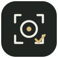
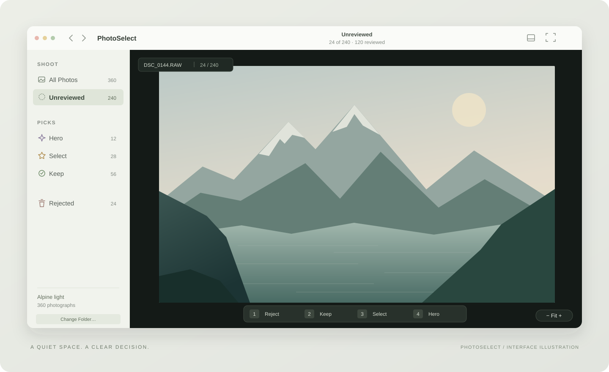

<div align="center">



# PhotoSelect

<p><a href="README.md">English</a> · <strong>简体中文</strong></p>

### 把注意力，留给照片。

原生 macOS 选片工具 · 键盘分级 · 专注看图 · 本地保存

A quiet, native workspace for finding the photographs worth keeping.

<p>
  
  
  
  
</p>

<p>
  <a href="#quick-start">快速开始</a> ·
  <a href="#workflow">选片流程</a> ·
  <a href="#shortcuts">快捷键</a> ·
  <a href="#safety">文件安全</a> ·
  <a href="docs/DEVELOPMENT.zh-CN.md">开发指南</a> ·
  <a href="CONTRIBUTING.zh-CN.md">参与贡献</a>
</p>



<sub>界面示意图，以矢量绘制；实际界面随 macOS 版本与窗口尺寸变化。</sub>

</div>

<br>

打开一组拍摄素材，用方向键看图，用 `1 / 2 / 3 / 4` 作出判断。PhotoSelect 将未审阅、保留、精选和淘汰放进一个轻量工作区，让你把精力放在照片上。原图留在原来的文件夹，选片决定保存在本机。

> **当前阶段：** MVP v2，供从源码构建与试用。基本选片流程已实现，真实大批量 RAW 素材的速度和稳定性仍需验证。构建、测试与已知限制见[开发指南](docs/DEVELOPMENT.zh-CN.md#verification)。

## 一张照片，一次判断

| 能力 | 当前体验 |
| :--- | :--- |
| **打开即看** | 直接读取文件夹，分批索引；支持 JPEG、HEIC、PNG、TIFF，以及系统能够解码的 RAW。 |
| **键盘选片** | 四级决策、自动下一张、分类回看和撤销，减少鼠标操作。 |
| **专注检查** | `F` 隐藏侧栏与缩略图条；触控板捏合缩放、双指平移，随时回到 Fit。 |
| **继续上次进度** | 保存选片决定与偏好，恢复上次文件夹，提供最近八个文件夹入口。 |
| **按浏览顺序预加载** | 预取当前筛选中的相邻照片，优先准备后续帧，复用主预览缓存。 |
| **明确处理淘汰片** | Reject 先记录决定；在 Rejected 中确认具体数量后，才移到系统废纸篓。 |

<a id="quick-start"></a>

## 快速开始

需要 **macOS 14 或更高版本**，以及支持目标系统的完整 **Xcode**。当前提供源码构建方式，尚未提供签名、公证的安装包。

```bash
git clone https://github.com/jianyuanliljy-hub/PhotoSelect.git
cd "PhotoSelect"
open "PhotoSelect.xcodeproj"
```

在 Xcode 中选择 **PhotoSelect → My Mac**，点击 Run（`⌘R`）。如果提示签名配置，在 **Signing & Capabilities** 中选择自己的 Development Team。

仓库已包含 `.xcodeproj`，无需安装 XcodeGen。

<a id="workflow"></a>

## 从一组照片，到值得留下的几张

1. **打开拍摄文件夹。** 按 `⌘O`，照片会分批出现。默认进入 Unreviewed（未审阅），已有决定会恢复。
2. **开始第一轮筛选。** 用 `← / →` 浏览，用 `1 / 2 / 3 / 4` 分级。自动下一张默认开启。
3. **检查细节。** 捏合放大、双指平移；按 `⌘0` 回到完整画面。需要更大画布时按 `F`。
4. **回看留下的照片。** 在 Hero、Select、Keep 中分别复查。误判时用 `⌘Z` 撤销，或按 `0` 清除决定。
5. **最后处理淘汰片。** 进入 Rejected，检查后选择 Move to Trash，并确认文件数量。

未审阅数量归零后，界面会显示第一轮完成状态，可继续进入 Select 或 All Photos。分级只是 PhotoSelect 内部状态，当前界面尚未开放导出和 XMP 写入。

<a id="shortcuts"></a>

## 手留在键盘上

| 按键 | 操作 | 含义 |
| :---: | :--- | :--- |
| `1` | Reject · 淘汰 | 暂时标记，原图留在原处 |
| `2` | Keep · 保留 | 可用、值得保留 |
| `3` | Select · 精选 | 值得进一步处理 |
| `4` | Hero · 最佳 | 本组中的突出作品 |
| `0` | Unreviewed · 未审阅 | 清除当前决定 |

<details>
<summary><strong>完整快捷键</strong></summary>

| 操作 | 快捷键 |
| :--- | :--- |
| 上一张 / 下一张 | `←` / `→` |
| 当前筛选的第一张 / 最后一张 | `⌘←` / `⌘→` |
| 撤销上一次决定 | `⌘Z` |
| 打开文件夹 | `⌘O` |
| 切换专注模式 | `F` |
| 显示 / 隐藏缩略图条 | `⌥⌘F` |
| 放大 / 缩小 | `⌘+` / `⌘−` |
| 适应窗口 | `⌘0` |

</details>

<a id="safety"></a>

## 原图与决定，各有去处

**分级不移动原图。** Hero、Select、Keep 和 Reject 都是本地决定。只有 Rejected → Move to Trash 的确认操作会移动原文件，使用标准 macOS 废纸篓 API；移动失败的文件继续保留在列表中。

**选片记录在本机。** 决定通过 JSON 快照与追加日志保存；沙箱目录下的实际位置和备份建议见[数据存储说明](docs/DEVELOPMENT.zh-CN.md#storage)。文件夹访问使用 macOS 安全作用域书签（security-scoped bookmarks）。

**路径就是当前的关联依据。** 在外部移动或重命名原图后，已有决定无法自动关联到新路径。撤销历史只保留在当前运行期间，重启后不恢复。重要素材仍应保持独立备份。

## 边界清楚，逐步完善

| 状态 | 内容 |
| :--- | :--- |
| **已实现** | 单图选片、四级决策、分类导航、撤销、缩放与平移、专注模式、进度持久化、最近文件夹、确认后移入废纸篓 |
| **需要继续验证** | 大批量混合 JPEG / RAW 的真实浏览延迟、长时间使用稳定性、不同相机 RAW 兼容性 |
| **下一步优先** | 先验证真实拍摄素材的基础选片体验，再进入多图对比（Compare Mode） |
| **暂未开放** | 同步对比、连拍分组、XMP、AI 选片、导出界面、完整 EXIF 面板、两阶段高质量 RAW 渲染 |

RAW 兼容性取决于当前 macOS 的 ImageIO / Quick Look 解码器。缩放倍率相对于 Fit，当前范围为 1×–8×，不等同于传感器原始像素的 100% 检查。目录扫描包含子文件夹，目前没有拍摄时间排序或排除子文件夹选项。

## 面向开发者

项目使用 **SwiftUI + AppKit**，不引入第三方依赖。界面、选片状态、图像解码与持久化各有明确职责。

```text
PhotoSelect/
├── Models/             照片身份、决定与元数据
├── Stores/             选片状态、导航、撤销与文件操作
├── Services/           解码缓存、决定持久化、书签与元数据读取
└── Views/              SwiftUI 界面与 AppKit 缩放视图
PhotoSelectTests/       XCTest 测试
docs/                   开发说明与项目视觉资源
```

图像管线提供 `320 px` 缩略图、`3200 px` 主预览和 `7680 px` 放大检查三个请求档位，实际图像尺寸受原图与解码器限制。预加载跟随当前筛选序列，按下一张优先的顺序执行，减少后台解码与前台浏览的竞争。

[构建与测试](docs/DEVELOPMENT.zh-CN.md#build) · [验证记录](docs/DEVELOPMENT.zh-CN.md#verification) · [产品说明](PRODUCT_SPEC.md) · [v2 调整原因](V2_AUDIT.md) · [贡献指南](CONTRIBUTING.zh-CN.md) · [安全报告](SECURITY.zh-CN.md)

<details>
<summary><strong>常见问题</strong></summary>

**可以直接下载安装吗？**

目前需要从源码构建，尚未提供签名、公证的安装包。

**有 Windows 或 Linux 版本吗？**

当前仅面向 macOS，使用 SwiftUI、AppKit 和系统图像解码能力。

**能够把精选照片导出到其他目录吗？**

仓库保留了复制导出的辅助代码与测试，当前 MVP 界面未开放该功能。

**为什么没有测试 passing 徽章？**

2026-10-22 的本地构建成功，测试目标完成编译；测试运行器被执行环境的沙箱权限阻断，未获得完整测试通过结果。详细记录见[开发指南](docs/DEVELOPMENT.zh-CN.md#verification)。

**采用什么许可证？**

当前尚未选定开源许可证，授权条款将单独明确。

</details>

---

<div align="center">
<sub>PhotoSelect · 摄影之后，精修之前。<br>Built for the space between shooting and editing.</sub>
</div>
